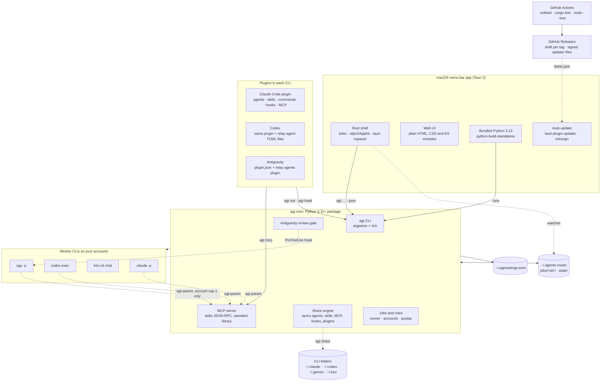

# Tech stack

This page shows the parts of Agents Router (`agt`), the languages and libraries each uses, and how they connect.

| Part | Stack | Where |
|---|---|---|
| agt core | Python 3.11+ package `agents-router`, standard library, `argparse` CLI. Installed with `uv tool` or `pipx`. Entry points `agt` and `agents-router-mcp`. | [src/agents_router/](../src/agents_router/), [pyproject.toml](../pyproject.toml) |
| MCP server | JSON-RPC 2.0 over stdio, written on the standard library. The plugin starts it as `agt mcp`. Workers reach it as `agt-parent` (`agt mcp --worker <job_id>`): Claude Code and Codex workers always, Antigravity workers only when the account's job cap is exactly 1, Kiro workers never. | [mcp_server.py](../src/agents_router/mcp_server.py), [mcp_config.json](../mcp_config.json) |
| Share engine | Standard library. Writes each CLI's own format: Markdown with frontmatter, Codex TOML, Kiro JSON. The launcher, a macOS LaunchAgent and agt's hook entries run it in the background. | [src/agents_router/share/](../src/agents_router/share/) |
| Jobs and roles | One folder per job (`spec.json`, `status.json`, `events.jsonl`, `result.md`), a detached runner process, account pools with cooldowns and quotas, roles from `[roles.*]` settings. | [jobs.py](../src/agents_router/jobs.py), [runner.py](../src/agents_router/runner.py), [accounts.py](../src/agents_router/accounts.py), [roles.py](../src/agents_router/roles.py) |
| Antigravity review gate | Standard library, self-contained package. A PreToolUse hook on `agy` workers: fixed rules, then a reviewer model. | [src/agents_router/agy_review/](../src/agents_router/agy_review/) |
| Worker runtimes | Subprocesses: `claude -p --output-format stream-json`, `codex exec`, `kiro-cli chat --no-interactive`, `agy -p --output-format stream-json`. | [src/agents_router/runtimes/](../src/agents_router/runtimes/) |
| macOS app shell | Rust 2021 on Tauri 2 (tray icon, private macOS API), tauri-nspanel, objc2 with AppKit, tokio, serde, notify-debouncer-mini on FSEvents. Tauri plugins: updater, autostart, single-instance, dialog, process. `client.rs` runs `agt … --json` as a subprocess; `watcher.rs` watches the state and jobs folders. | [macos/src-tauri/](../macos/src-tauri/) |
| macOS app UI | HTML, CSS and JavaScript ES modules, bundled by Vite 8 into `build/ui-dist` with Node 24 pinned in `scripts/node-runtime.lock`. Both windows are React 19 in strict TypeScript 7. Logic tests run with `node --test macos/ui/logic`; React component tests with Vitest and Testing Library in jsdom (`scripts/build_app_ui.py --test`). | [macos/ui/](../macos/ui/), [macos/README.md](../macos/README.md#web-ui-build) |
| Bundled Python | Python 3.13 from Astral's python-build-standalone, with rich and rich-argparse. `build_app.py` puts it in `Contents/Resources/runtime`; the app installs it under `runtimes/<version>`, and its stable `agt` launcher runs on it. | [python-runtime.lock](../scripts/python-runtime.lock), [build_app.py](../scripts/build_app.py) |
| Plugins | Claude Code: `.claude-plugin/` (`plugin.json`, `marketplace.json`), relay agents `agents/agt-*.md`, `skills/`, `commands/delegate.md`, `hooks/hooks.json` (`agt hook …`), `mcp_config.json`. Codex installs the same plugin; setup adds the relay agents as TOML in `~/.codex/agents/`. Antigravity installs the root `plugin.json` with `agy plugin install`; setup adds the `agents-router-relays` plugin. | [.claude-plugin/](../.claude-plugin/), [agents/](../agents/), [skills/](../skills/), [commands/](../commands/), [hooks/](../hooks/), [plugin.json](../plugin.json), [templates/](../src/agents_router/templates/) |
| Settings and state | TOML settings: `~/.agt/settings.toml` (moved by `AGT_CONFIG_DIR` or `AGT_HOME`), `<workspace>/.agt/settings.toml` and `<workspace>/.agt/settings.local.toml`. State in `~/.agents-router/` (moved by `AGT_HOME`): `jobs/<job_id>/`, `state/`, `homes/`. | [config.py](../src/agents_router/config.py), [levels.py](../src/agents_router/levels.py), [jobs.py](../src/agents_router/jobs.py) |
| CI and release | GitHub Actions. `tests.yml`: unittest on Ubuntu and macOS with Python 3.11 and 3.13. `release.yml` on macOS 15: packaging checks, the UI typecheck, component tests and Vite build, `cargo test --locked`, `node --test macos/ui/logic`, `agt-app-check`, the app build and its self-test. A `v*` tag makes a draft GitHub release with minisign-signed updater files and `latest.json`. | [.github/workflows/](../.github/workflows/) |
| Antigravity adapter (superseded) | Python with the MCP SDK's FastMCP, and pywinpty for ConPTY on Windows. Replaced by the Antigravity runtime and the review gate; kept only for AGY versions that print nothing to a pipe. | [adapters/antigravity/](../adapters/antigravity/) |

## Dependencies

- The core runs on the Python standard library. Its two third-party packages are rich and rich-argparse. Only [ui.py](../src/agents_router/ui.py) imports them, inside functions, to draw output for a person at a terminal. Hooks, the MCP server, agents and pipes get its plain renderer.
- The app pins its Rust crates in [Cargo.toml](../macos/src-tauri/Cargo.toml) and the bundled Python with its packages in [python-runtime.lock](../scripts/python-runtime.lock).
- The superseded adapter lists its own packages in [requirements.txt](../adapters/antigravity/requirements.txt).

The design and the reasons behind it: [Design and build plan](design.md). App build and test commands: [macos/README.md](../macos/README.md).
